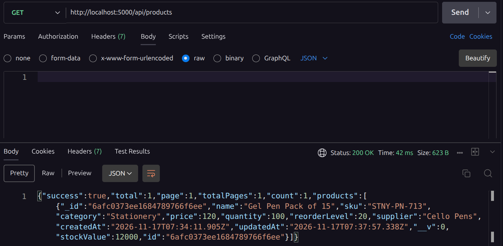
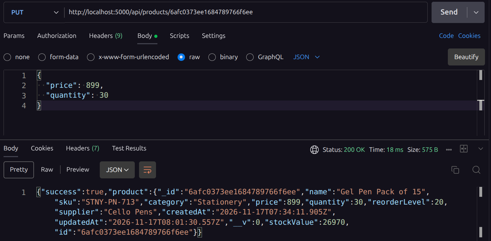
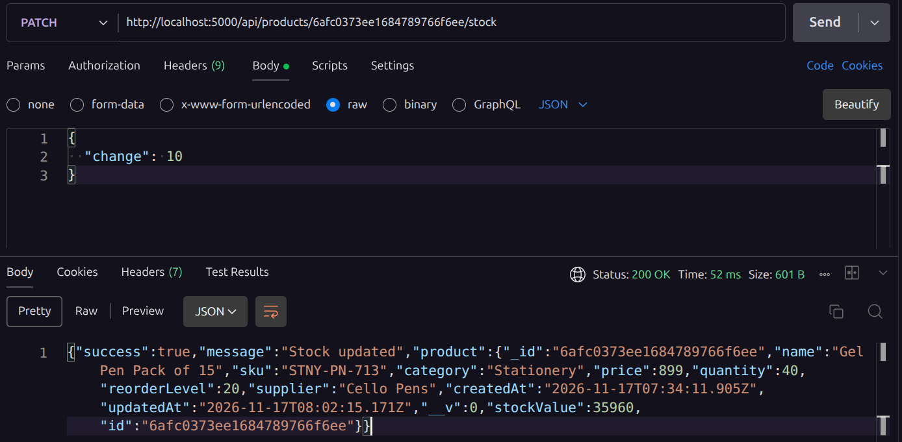
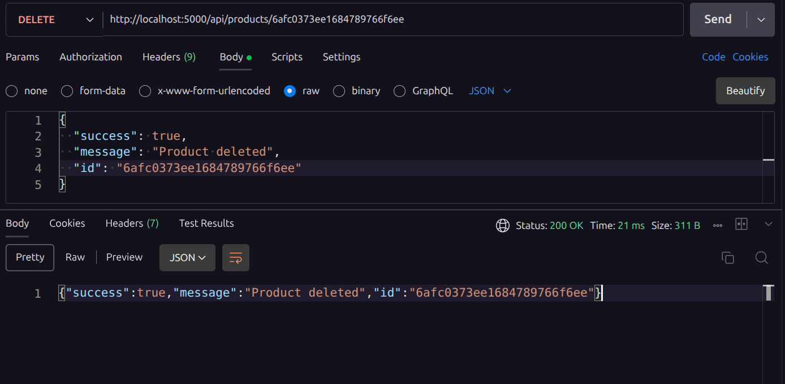

# Inventory and Data Management System — Lab 3

**Course:** Web Dev III | **Unit:** 3 | **Assignment:** 3

A RESTful inventory backend built with Node.js, Express.js, MongoDB, Mongoose and dotenv, matching the supplied lab brief.

## Features
- Mongoose Product schema with field-level validation and unique SKU
- Create, read, update and delete product endpoints
- Catalogue filtering, text search, sorting and pagination
- Atomic stock adjustment for restocking and sales (prevents negative stock)
- Low-stock alert report (`quantity <= reorderLevel`)
- Category-wise inventory aggregation (item count, quantity, stock value, average price)
- Centralized 404/error handling and environment configuration

## Requirements
- Node.js 18 or newer
- MongoDB Community Server running locally, or a MongoDB Atlas connection string

## Setup
1. Open this folder in a terminal.
2. Install dependencies:
   ```bash
   npm install
   ```
3. Copy `.env.example` to `.env`.
4. Keep the local MongoDB URI in `.env`, or replace it with your MongoDB Atlas URI:
   ```env
   PORT=5000
   MONGODB_URI=mongodb://127.0.0.1:27017/inventory_management
   NODE_ENV=development
   ```
5. Start the server:
   ```bash
   npm run dev
   ```
   Or use `npm start`.

The API runs at `http://localhost:5000`.

## API Endpoints & Testing

### 1. GET All Products


### 2. PUT Product


### 3. PATCH Product


### 4. DELETE Product

# inventory-data-management
